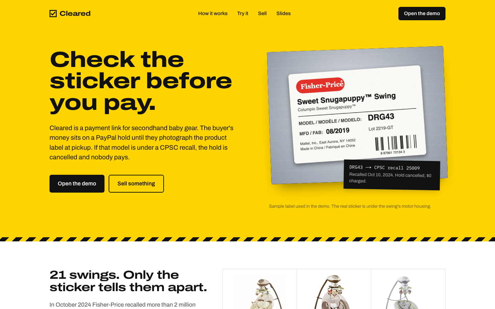
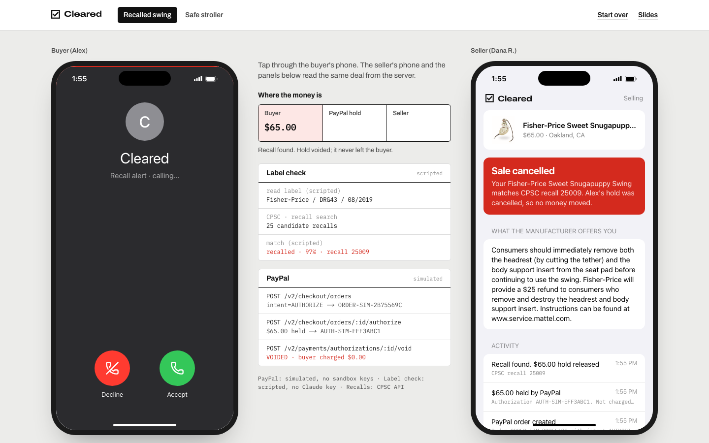
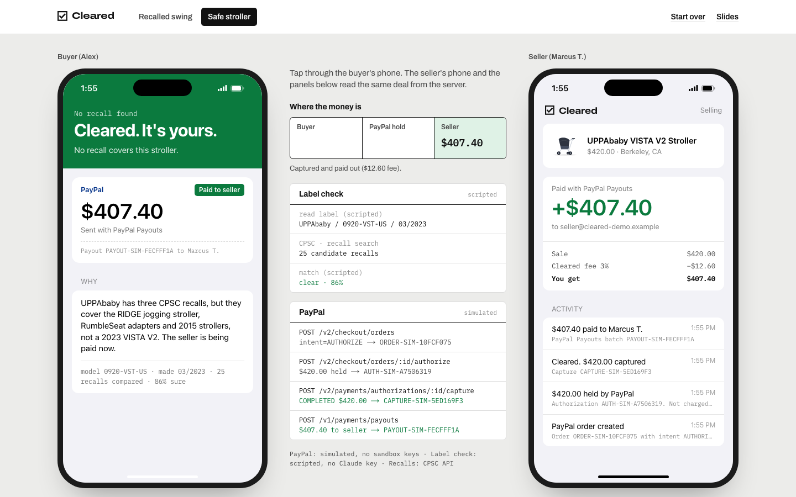
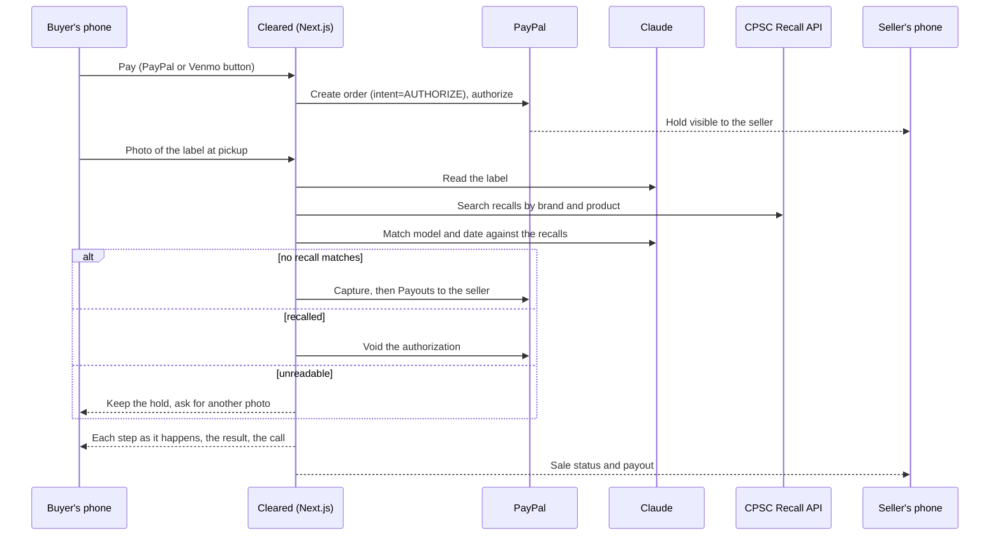

# Cleared

**Check the sticker before you pay.**

Cleared is a payment link for secondhand baby gear. The buyer pays with PayPal, but the money is only put on hold. At pickup, the buyer photographs the product's model sticker. Claude reads the brand, model number and manufacture date, and Cleared compares them against the U.S. Consumer Product Safety Commission (CPSC) recall database. Only then does any money move.

| Result | What PayPal does | Buyer pays | Seller gets |
| --- | --- | --- | --- |
| No recall matches | Captures the hold, then pays the seller with Payouts | The listing price | The price minus a 3% fee |
| A recall covers this model | Voids the hold | $0 | The manufacturer's remedy from the recall notice |
| Label can't be read | Keeps the hold | Nothing yet | Nothing yet; the buyer takes another photo |



## Why

In October 2024 Fisher-Price recalled more than 2 million Snuga infant swings for a suffocation hazard ([CPSC recall 25009](https://www.cpsc.gov/Recalls/2025/Fisher-Price-Recalls-More-than-2-Million-Snuga-Infant-Swings-Due-to-Suffocation-Hazard-After-5-Deaths-Reported)). The recall covers 21 model numbers that look nearly identical. The only way to tell whether a swing is one of them is the sticker under the motor housing. In a secondhand sale nobody reads that sticker before the money changes hands, and cash can't be taken back afterwards.

PayPal can authorize a payment without capturing it. Cleared uses that window to run the check.

## The demo

`/demo` shows both sides of one sale: the buyer's phone, the seller's phone, and in between, where the money is, each step of the label check, and every PayPal call the deal has made. Pick the recalled swing or the safe stroller and tap through the buyer's phone.

**Recalled swing.** Model DRG43 matches recall 25009. The hold is voided, the buyer gets a call that reads out the result, and the seller sees the cancelled sale along with Fisher-Price's remedy.



**Safe stroller.** No CPSC recall covers a 2023 UPPAbaby VISTA V2. The hold is captured and the seller is paid out.



Other pages:

| Route | What it is |
| --- | --- |
| `/` | Landing page |
| `/demo` | Buyer and seller side by side (shown above) |
| `/buy/[listingId]` | The buyer app. Full screen on a phone, where the camera button opens the camera. |
| `/sell` | Create a listing and get a link to paste into a Marketplace, Craigslist or Nextdoor post |
| `/sell/[listingId]` | The seller app, following the newest sale of that listing |
| `/pitch` | Slides. Arrow keys, space or click to advance. |

## How PayPal is used

All PayPal calls are in [`src/lib/paypal.ts`](src/lib/paypal.ts) and go to the sandbox (`api-m.sandbox.paypal.com`).

| Step | PayPal API | Code |
| --- | --- | --- |
| Buyer approves a hold, not a charge | JS SDK buttons loaded with `intent=authorize` and `enable-funding=venmo` | [`paypal-buttons.tsx`](src/components/paypal-buttons.tsx) |
| Create the order | `POST /v2/checkout/orders` with `intent: "AUTHORIZE"`; `custom_id` is the deal id | [`api/deals`](src/app/api/deals/route.ts) |
| Place the hold | `POST /v2/checkout/orders/{id}/authorize` | [`api/deals/[id]/authorize`](src/app/api/deals/[id]/authorize/route.ts) |
| Item clears | `POST /v2/payments/authorizations/{id}/capture` with `final_capture: true` | [`api/deals/[id]/check`](src/app/api/deals/[id]/check/route.ts) |
| Pay the seller | `POST /v1/payments/payouts`; `sender_batch_id` is `cleared-{dealId}`, so a retry can't pay twice | same |
| Item is recalled | `POST /v2/payments/authorizations/{id}/void` | same |
| PayPal confirms | Webhook events are matched to the deal and added to its activity | [`api/paypal/webhook`](src/app/api/paypal/webhook/route.ts) |

Every write sends a `PayPal-Request-Id` header for idempotency.

The platform captures the payment and then pays the seller with Payouts, because an Orders v2 payment lands in the platform's account. This is also what makes the fee possible, and it means money for a recalled item never reaches the seller.

## How Claude is used

[`src/lib/verifier.ts`](src/lib/verifier.ts) makes two calls to `claude-opus-5-5`. Both return structured output validated against zod schemas.

1. **Read the label.** The photo goes in, and brand, product name, model number, manufacture date and search terms come out. The prompt forbids guessing. If the model number isn't legible, Claude returns `readable: false` and the hold stays.
2. **Match against recalls.** [`src/lib/recalls.ts`](src/lib/recalls.ts) searches the CPSC Recall API by brand, manufacturer and product terms, removes duplicates and ranks the results. Claude then decides `recalled`, `clear` or `needs_review` with a confidence score. A recall only counts if the model number and date fall inside its scope, so a recall on a brand's jogging stroller doesn't block its city stroller. Claude also writes the short message the buyer hears on the call, which the browser reads aloud with captions.

The check route streams each step to the phone as NDJSON, so the buyer watches it happen.

Requests use the server-side fallback beta (`fallbacks: "default"`). If the main model is unavailable, the request is retried on a fallback model instead of failing.

## Run it

Node 20 or newer.

```bash
npm install
cp .env.example .env.local
npm run dev
```

Then open http://localhost:3000/demo.

**Without any keys**, the whole flow still runs. PayPal calls are simulated (IDs look like `ORDER-SIM-…`), and a scripted verifier stands in for Claude on the three sample labels. The scripted verifier still searches the real CPSC API. The demo and buyer pages say which parts are simulated.

**For real sandbox payments:**

1. In the [PayPal developer dashboard](https://developer.paypal.com), go to Apps & Credentials → Sandbox and create an app with Payouts enabled.
2. Put the client ID in `PAYPAL_CLIENT_ID` and `NEXT_PUBLIC_PAYPAL_CLIENT_ID`, and the secret in `PAYPAL_CLIENT_SECRET`.
3. Set `SELLER_SANDBOX_EMAIL` to a sandbox personal account to receive payouts. Pay from a different sandbox personal account.
4. Optional: point a webhook at `https://<your-host>/api/paypal/webhook`.

**For real label reading**, set `ANTHROPIC_API_KEY`. Any photo of a real product label will then work, not just the samples.

Sales are stored in `.data/db.json`. Delete it to start fresh.

## How it fits together



```
src/
  app/
    api/            deals, authorize, check, listings, config, PayPal webhook
    demo/           buyer and seller side by side
    buy/ sell/      the buyer and seller apps on their own
    pitch/          slides
  components/       buyer app, seller app, money card, call screen, PayPal buttons
  lib/
    paypal.ts       Orders v2, Authorizations, Payouts
    verifier.ts     Claude label reading and recall matching
    recalls.ts      CPSC Recall API search
    labels.ts       sample label photos, drawn on a canvas
    store.ts        JSON file store
```

Built with Next.js 16, React 19, TypeScript, Tailwind CSS 4, Motion, the Anthropic TypeScript SDK and zod. Recall data and the Snuga swing photos come from the U.S. CPSC.

## Limits

- Sandbox only. No real money moves.
- CPSC covers U.S. consumer products. Car seats are recalled through NHTSA, which isn't connected.
- "No recall matches" means no CPSC recall covers the model on the label. It is not an inspection of the item's condition.
- The store is a JSON file, which is fine for a demo but not for more than one server.

## License

[MIT](LICENSE)
